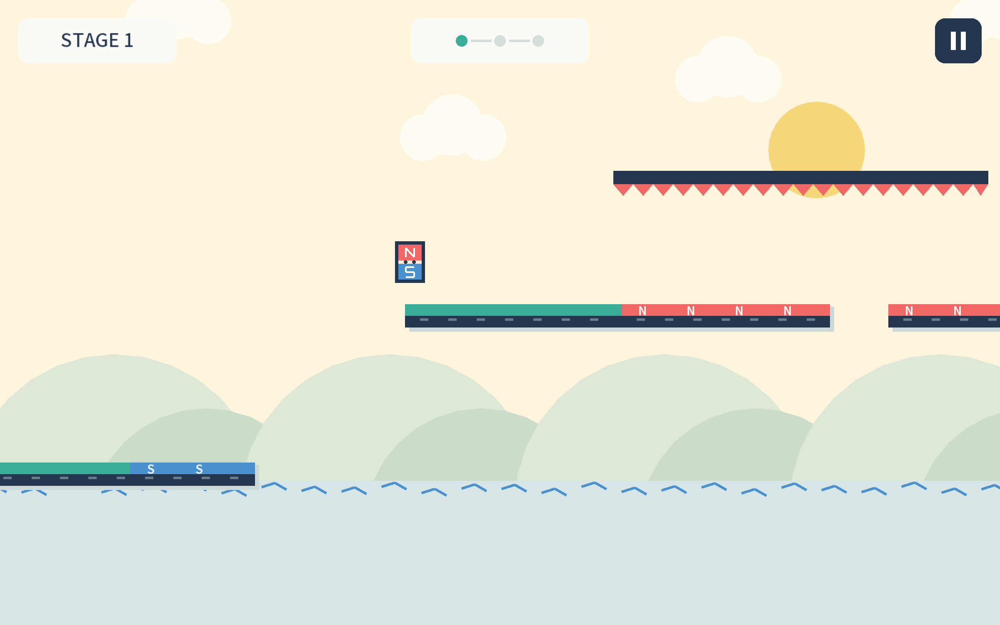

# 자석의 모험 · MAGNET HOP

자석의 극성에 따라 점프 높이와 이동 방법이 달라지는 LibGDX 2D 플랫포머입니다. 세 스테이지에서 높은 발판, 천장 가시, 움직이는 자석을 지나 도착 지점까지 이동합니다.



## 게임 실행

[실행 파일 ZIP](https://github.com/zvn86rwbhn-ux/magnet-hop/releases/latest/download/Magnet-Adventure-portable.zip)을 내려받아 압축을 풀고, Java 17이 설치된 컴퓨터에서 운영체제에 맞는 파일을 실행합니다.

| 운영체제 | 실행 파일 |
| --- | --- |
| Windows x64 | `Run-Windows.bat` |
| macOS | `Run-Mac.command` 또는 `sh Run-Mac.command` |
| Linux x64 데스크톱 | `sh Run-Linux.sh` |

Apple Silicon Mac에서 전체 스테이지 완주를 확인했습니다. Windows, Linux, Intel Mac은 실기 실행을 확인하지 않았습니다.

| 입력 | 동작 |
| --- | --- |
| 좌우 방향키 또는 A / D | 이동 |
| Space | 점프 / 천장 자석에서 내려오기 |
| Esc | 일시정지 / 재개 |
| H | 도움말 |
| R | 현재 스테이지 재시작 |
| Enter | 시작 / 다음 스테이지 / 클리어 후 처음부터 재시작 |
| M | 소리 켜기 / 끄기 |

## 게임 규칙

- 일반 바닥은 기본 점프, 파란 S 바닥은 높은 점프, 빨간 N 바닥은 낮은 점프입니다.
- 머리 N극이 천장 S극에 가까워지면 붙습니다. 움직이는 자석에 매달려 위치를 조절할 수 있습니다.
- 노란 버튼 위로 내려와 착지하면 연결된 바닥의 극이 바뀝니다.
- 가시에 닿거나 아래로 떨어지면 현재 스테이지 처음부터 재시도합니다.

## 소스에서 실행

JDK 17 환경에서 Gradle 래퍼를 사용합니다. Windows에서는 `./gradlew` 대신 `gradlew.bat`을 사용하세요.

```sh
./gradlew :lwjgl3:run
```

```sh
./gradlew :core:verifyGame :core:verifyTiming :core:verifyFeedback :lwjgl3:jar
```

게임 규칙과 스테이지는 `core`, 데스크톱 실행 코드는 `lwjgl3`, 글꼴과 효과음은 `assets`에 있습니다. 사용한 라이브러리와 에셋 출처는 [THIRD-PARTY.md](THIRD-PARTY.md)를 참고하세요.
